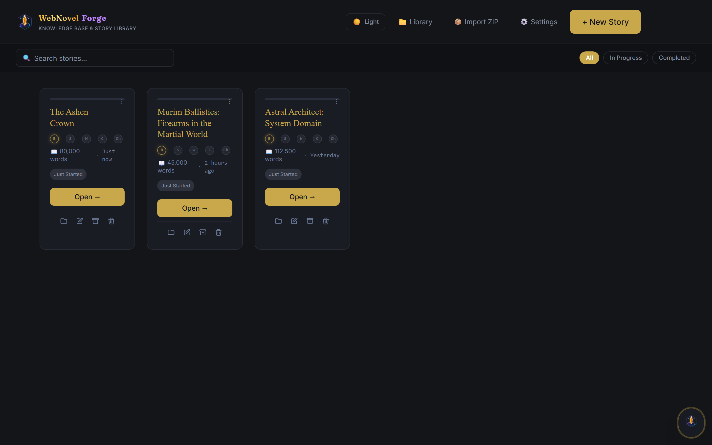
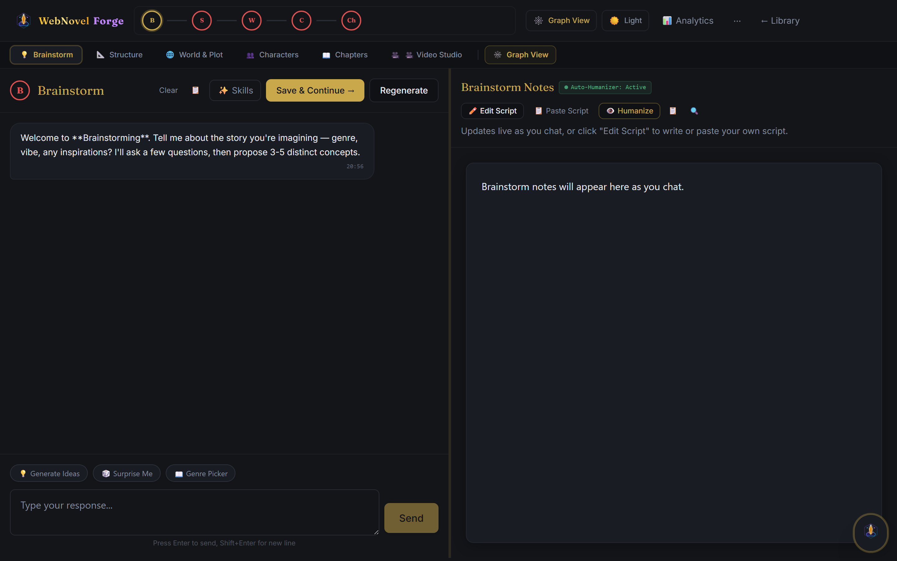
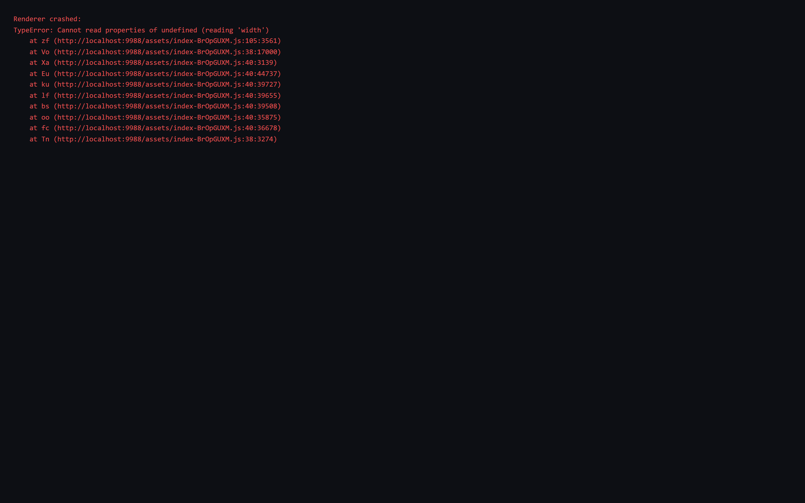

<div align="center">


# WebNovel Forge ⚡
### AI-Powered Web Novel Studio & Multi-Engine Animation Suite

[](package.json)
[](release/)
[](release/)
[](release/)
[](src/renderer/)
[](tsconfig.json)
[](vite.config.ts)
[](src/main/securityUtils.ts)
[](LICENSE)

<p align="center">
  <strong>Craft sprawling web novels, maintain zero-plot-hole continuity, and generate cinematic book trailers in one cohesive desktop workspace.</strong>
  <br />
  Tailored for Progression Fantasy, LitRPG, Wuxia/Xianxia, Grimdark, and Sci-Fi authors.
</p>

[⬇️ Download Windows Installer](#-installation--downloads) • [✨ Key Features](#-key-features) • [🎬 Video Animation Studio](#-multi-engine-video-studio) • [🛡️ Security Architecture](#%EF%B8%8F-enterprise-security-architecture) • [🚀 Quick Start](#-developer-quickstart)

</div>

---

## 📸 Interface Preview

### 📚 Novel Library Manager
Manage multiple universes, word metrics, and chapter completion progress from an atmospheric dark workstation.



---

### 🖋️ 5-Phase Story Studio & Continuity Engine
Orchestrate premise generation, beat structuring, faction world-building, character sheets, and chapter generation with real-time fact checks.



---

### 🎥 Multi-Engine Video & Trailer Studio
Generate animated cliffhangers, lore breakdowns, and social video shorts straight from your novel chapters.



---

## ✨ Key Features

### 1. 🧠 5-Phase AI Story Generation Pipeline
Move beyond single-prompt chatbots into a disciplined writing framework:
* **Phase 1: High-Concept Brainstorming** — Extract unique hooks, power systems, core conflicts, and tropes.
* **Phase 2: Narrative Beat Structuring** — Scaffold plot arcs using industry frameworks (*Save the Cat!*, *Hero's Journey*, *Dan Harmon Story Circle*, *Kishōtenketsu*).
* **Phase 3: Deep World Bible & Plot Outline** — Build codified laws of magic, faction hierarchies, geopolitical tension, and chapter-by-chapter beat sheets.
* **Phase 4: Character Fact Locking** — Define protagonists, foils, and antagonists with tracked status, motives, combat tiers, and evolving relationship dynamics.
* **Phase 5: Chapter Writing & Humanizer Loop** — Generate rich 2,500–5,000 word chapters while automatically filtering overused AI clichés and repetitive sentence patterns.

### 2. 🛡️ Real-Time Continuity Guardian & Rolling Summary
* **Fact-Locked Memory**: Automatically verifies character traits, acquired abilities, and active vows against draft prose.
* **Rolling Summary Indexer**: Updates story state after each completed chapter to keep LLMs context-aware across 100+ chapter sagas.
* **Repetition Blocklist**: Global and per-novel banned phrase filters catch AI tropes (*"a testament to"*, *"little did he know"*, *"tapestry"*).

### 3. 🎬 Multi-Engine Video Animation Studio
Bring your web novel to life across TikTok, YouTube Shorts, and Webtoon trailers:
* **Hyperframes Engine**: Dynamic HTML/CSS/GSAP timeline video rendering.
* **Remotion Engine**: Programmatic React-based kinetic typography and chapter teasers.
* **Manim Engine**: Mathematical visualizations for cultivation paths, mana grids, and stats.
* **Motion Canvas & HTML-Video**: Interactive 2D vector animation canvases.

### 4. 🌐 Local & Cloud LLM Sovereignty (BYOK)
* **Local Privacy (Ollama)**: Run offline with local open weights (`DeepSeek-R1`, `Qwen 2.5 72B`, `Mistral Nemo`).
* **Cloud Power (OpenRouter & NVIDIA NIM)**: Stream state-of-the-art models with live token metrics.
* **Zero Vendor Lock-In**: Store projects in portable, human-readable `.md` and `.json` alongside embedded SQLite (`sql.js` WebAssembly).

---

## 🛡️ Enterprise Security Architecture

WebNovel Forge incorporates rigorous defense-in-depth engineering verified through automated security audits:

| Security Vector | Implementation Detail | Status |
|---|---|---|
| **Iframe Sandbox Isolation** | Video Studio previews run in isolated `sandbox="allow-scripts"` with `srcdoc`, strictly disallowing parent IPC bridge escapes. | ✅ Confined |
| **Path Traversal Defense** | Strict canonical root confinement (`assertSafeSubpath`) blocks directory traversal (`../`) across all reads, writes, and deletions. | ✅ Hardened |
| **Zero Shell Injection** | Eliminated shell string interpolations; all child processes (`powershell.exe`, `python`, `npx`) execute with discrete argument arrays. | ✅ Parameterized |
| **SQL Query Guardrails** | Renderer-level IPC SQL gateway verifies path containment and blocks stacked statements (`;`) and administrative SQLite pragmas. | ✅ Enforced |
| **Encrypted Credential Storage** | Cloud API keys (`openRouterApiKey`, `nvidiaApiKey`) are encrypted at rest using Windows DPAPI via Electron `safeStorage`. | ✅ Encrypted |
| **Renderer Sandbox & CSP** | `sandbox: true` enabled on browser webPreferences; strict Content Security Policy (`<meta>` tag) prevents unapproved script/origin execution. | ✅ Protected |

---

## 📦 Installation & Supported Platforms

WebNovel Forge is engineered for native performance across Windows, macOS, and Linux:

| Platform | Format | Architecture | Status | Direct Download / CLI |
|---|---|---|---|---|
| **Windows** | `.exe` (NSIS Installer & Portable) | x64 | ✅ Supported | [Download Setup .exe](https://github.com/rushikin/webnovel-forge/releases/tag/v2.0.0) |
| **macOS** | `.dmg` & `.zip` | Apple Silicon (M1/M2/M3/M4) & Intel x64 | ✅ Supported | `npm run dist:mac` / `./LAUNCHER.sh` |
| **Linux** | `.AppImage` & `.deb` | x64 (Ubuntu, Debian, Fedora, Arch) | ✅ Supported | `npm run dist:linux` / `./LAUNCHER.sh` |

---

## 💻 CLI Download & Install Commands (By Operating System)

Choose your OS below to download, install, or launch WebNovel Forge directly from your terminal:

### 🪟 Windows (PowerShell / CMD)

**PowerShell One-Liner (Download & Launch Installer):**
```powershell
Invoke-WebRequest -Uri "https://github.com/rushikin/webnovel-forge/releases/download/v2.0.0/WebNovel.Forge.Setup.2.0.0.exe" -OutFile "$env:TEMP\WebNovelForgeSetup.exe"; Start-Process "$env:TEMP\WebNovelForgeSetup.exe"
```

**Command Prompt / curl:**
```cmd
curl -L -o "%TEMP%\WebNovelForgeSetup.exe" "https://github.com/rushikin/webnovel-forge/releases/download/v2.0.0/WebNovel.Forge.Setup.2.0.0.exe" && "%TEMP%\WebNovelForgeSetup.exe"
```

**Developer Clone & One-Click Start:**
```cmd
git clone https://github.com/rushikin/webnovel-forge.git && cd webnovel-forge && npm install && RUN_SINGLE_FILE.bat
```

---

### 🍎 macOS (Terminal / zsh / bash)

**One-Liner Clone & Launch:**
```bash
git clone https://github.com/rushikin/webnovel-forge.git && cd webnovel-forge && npm install && chmod +x LAUNCHER.sh && ./LAUNCHER.sh
```

**Build Standalone macOS `.dmg` Installer Locally:**
```bash
npm run dist:mac
# Output will be located in: release/WebNovel-Forge-2.0.0-mac.dmg
```

**Start in Development Mode:**
```bash
./LAUNCHER.sh --dev
```

---

### 🐧 Linux (Ubuntu, Debian, Fedora, Arch)

**One-Liner Clone & Launch:**
```bash
git clone https://github.com/rushikin/webnovel-forge.git && cd webnovel-forge && npm install && chmod +x LAUNCHER.sh && ./LAUNCHER.sh
```

**Build Native `.AppImage` & `.deb` Packages Locally:**
```bash
npm run dist:linux
# Outputs generated in release/:
#   - release/WebNovel-Forge-2.0.0-linux.AppImage
#   - release/WebNovel-Forge-2.0.0-linux.deb
```

**Install the `.deb` package (Debian / Ubuntu / Mint):**
```bash
sudo dpkg -i release/WebNovel-Forge-2.0.0-linux.deb
```

---

### 🐙 GitHub CLI (`gh`) — Universal

```bash
# Clone the repository
gh repo clone rushikin/webnovel-forge

# Or download latest release assets
gh release download v2.0.0 --repo rushikin/webnovel-forge
```

---

## 🚀 Quickstart

### Prerequisites
- [Node.js](https://nodejs.org/) (v18.x or v20.x LTS)
- [npm](https://www.npmjs.com/) (v9.x or v10.x)
- *(Optional for Video Trailers)* [FFmpeg](https://ffmpeg.org/)
- *(Optional for Local AI)* [Ollama](https://ollama.com/) running locally on port 11434

### 1. Clone & Setup
```bash
git clone https://github.com/rushikin/webnovel-forge.git
cd webnovel-forge
npm install
```

### 2. Single-Command Launchers

* **On Linux / macOS:**
  ```bash
  chmod +x LAUNCHER.sh
  ./LAUNCHER.sh          # Starts built app
  ./LAUNCHER.sh --dev    # Starts in development mode
  ```

* **On Windows:**
  ```cmd
  RUN_SINGLE_FILE.bat    # Or: node LAUNCHER.js
  ```

### 3. Build Executables & Installers

```bash
# Build for your current host operating system
npm run dist

# Target-specific packaging commands
npm run dist:win      # Windows Setup .exe (NSIS)
npm run dist:mac      # macOS .dmg & .zip (Universal)
npm run dist:linux    # Linux .AppImage & .deb
npm run dist:all      # Package all platform distributions
```

---

## 🛠️ Architecture & Tech Stack

```
webnovel-forge/
├── src/
│   ├── main/                  # Electron Main Process (Node.js)
│   │   ├── main.ts            # IPC controllers, window lifecycle, safe storage
│   │   ├── securityUtils.ts   # Canonical path confinement & SQL guardrails
│   │   ├── pipeline.ts        # 5-Phase autonomous story generation engine
│   │   ├── dataModel.ts       # SQLite WebAssembly (sql.js) schemas & file CRUD
│   │   ├── editorAgent.ts     # Continuity analyzer & fact checking agent
│   │   └── videoEngines/      # Hyperframes, Remotion, Manim render dispatchers
│   ├── renderer/              # React 18 User Interface (Vite)
│   │   ├── pages/             # Library, Workspace, Video Studio, Settings
│   │   ├── components/        # Timeline, Fact Inspector, Outline Grid
│   │   └── styles/            # Tailwind CSS design system & typography tokens
│   └── shared/                # Cross-process IPC types & contract definitions
├── assets/                    # Logos, SVG icons, and preview screenshots
└── package.json               # Build manifests & Electron configuration
```

- **Frontend**: React 18, TypeScript, Tailwind CSS, Lucide Icons, Vite
- **Desktop Runtime**: Electron 28 (sandboxed with context isolation)
- **Local Database**: WebAssembly SQLite (`sql.js`) with mutex locking
- **Video Compilers**: Hyperframes, Remotion, Manim, Motion Canvas

---

## 🤝 Contributing

Contributions, feature requests, and bug reports are welcome!
1. Fork the Project
2. Create your Feature Branch (`git checkout -b feature/AmazingFeature`)
3. Commit your Changes (`git commit -m 'feat: add amazing feature'`)
4. Push to the Branch (`git push origin feature/AmazingFeature`)
5. Open a Pull Request

---

## 📄 License

Distributed under the MIT License. See `LICENSE` for more information.

<div align="center">
  <sub>Built with craftsmanship for the future of digital literature.</sub>
</div>
